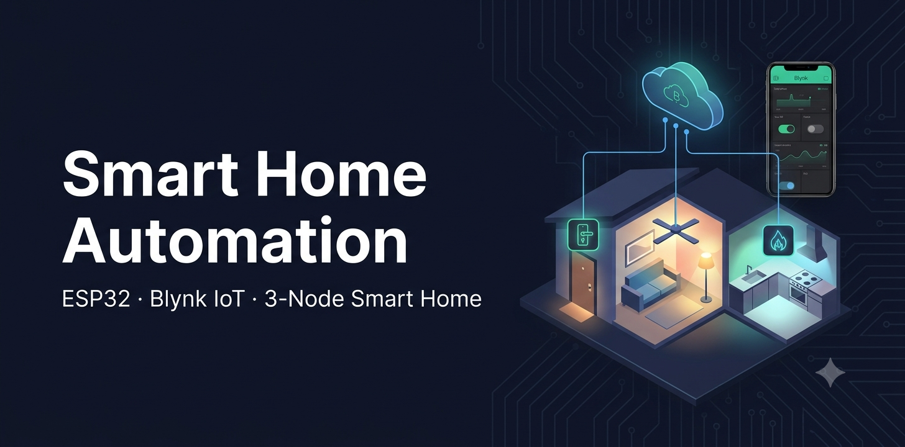
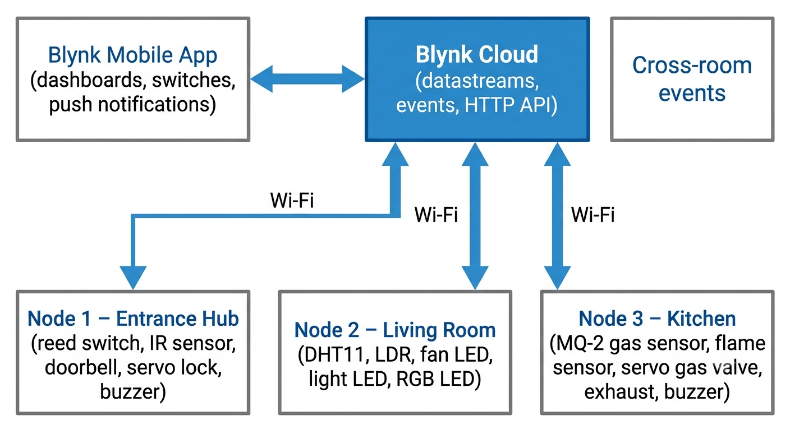
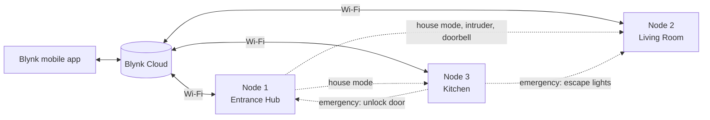
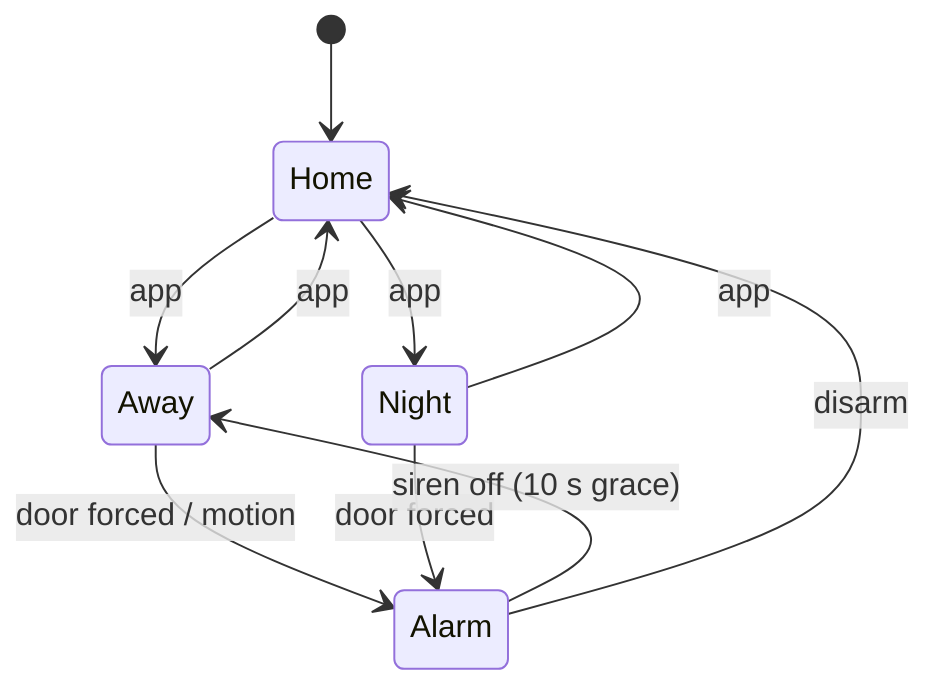
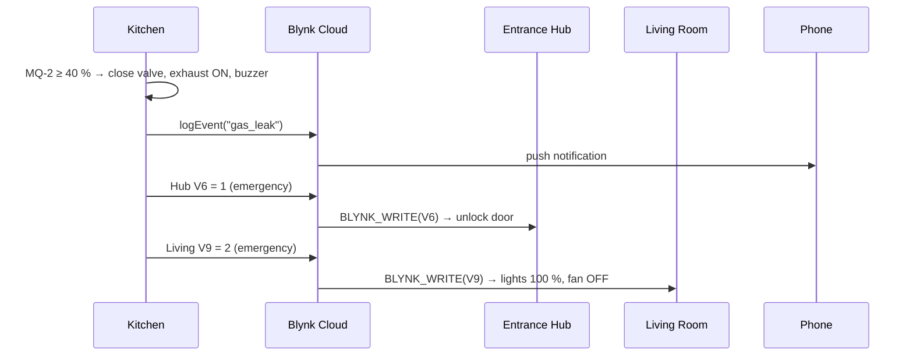
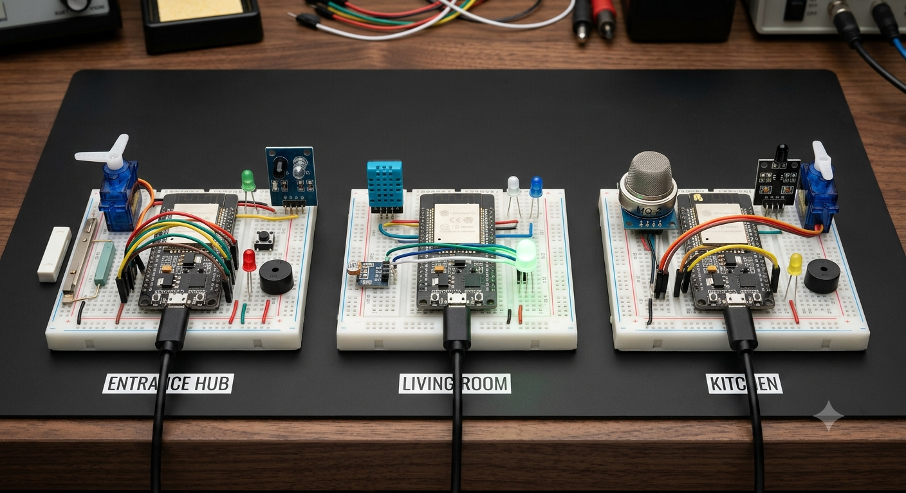
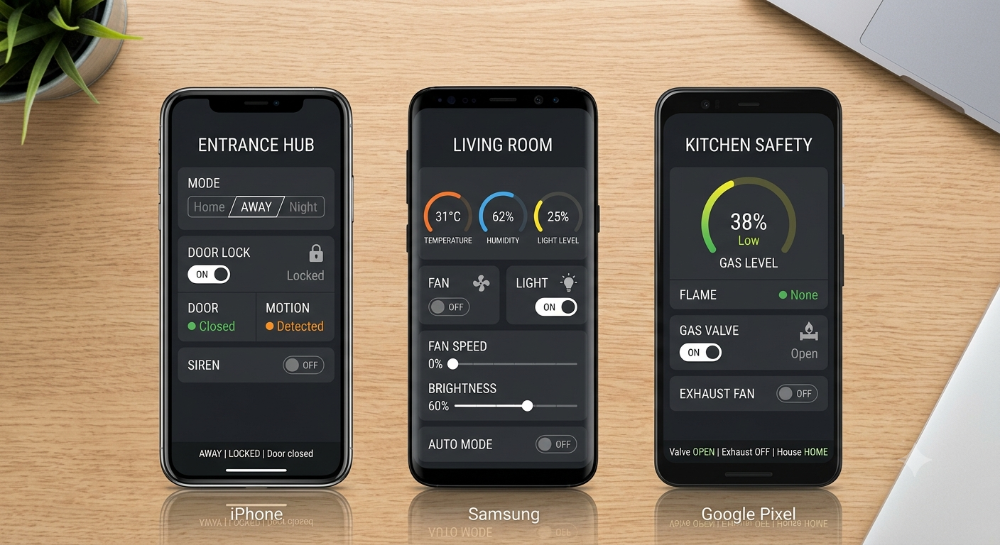
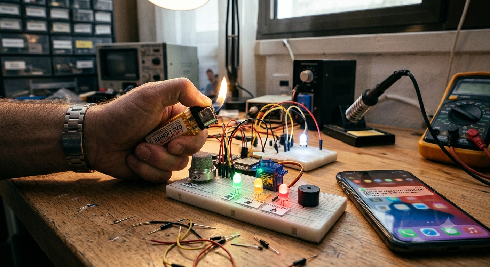

<p align="center">
  
</p>

<p align="center">
  
  
  
  
</p>

# Smart Home Automation System

A **3-node smart home** built with three ESP32 boards and the **Blynk IoT** cloud. Each room monitors and controls itself, and the rooms share the house mode and alerts, so an event in one room triggers actions in the others.

| Node | Role | Highlights |
| --- | --- | --- |
| **1 · Entrance Hub** | Security | Smart servo lock, auto-lock, smart doorbell, intruder alarm, holds the house mode |
| **2 · Living Room** | Comfort | Temperature-based fan speed, smart dimming light, night mode, RGB mood light |
| **3 · Kitchen** | Safety | Gas and fire detection, automatic gas valve shut-off, exhaust with air purge |

> **Course project:** 24EECE2031 · Introduction to IoT and Its Applications, Dept. of ECE, GITAM (Deemed to be University), Visakhapatnam, 2026–27.

---

## Features

- **House modes (Home / Away / Night)**: one switch in the app changes how every room behaves.
- **Smart lock**: lock or unlock from the phone; auto-locks 20 s after the door closes.
- **Remote guest entry**: unlock from the app while away and no alarm goes off; it re-locks and re-arms by itself.
- **Intruder alarm**: a forced door, or motion while away, sounds the buzzer, sends a phone alert and flashes the living room lights red.
- **Smart doorbell**: sends a phone notification and makes the living room lights blink yellow.
- **Comfort automation**: fan speed rises with temperature, and the light gets brighter as the room gets darker.
- **Gas and fire safety**: the valve closes, the exhaust runs, the **front door unlocks** and **escape lights** turn on, all automatically.
- **Cloud-friendly**: values are sent only when they change, keeping the system within the Blynk free plan.

## System architecture

<p align="center">
  
</p>



The nodes talk to each other through the **Blynk HTTP API**: a node updates a virtual pin on another node, which receives it as a normal `BLYNK_WRITE()` call.

## How it works

### House modes

| Node | Home | Away | Night |
| --- | --- | --- | --- |
| Entrance Hub | Security off; auto-lock | Door locks; armed after 10 s; door forced **or motion** → alarm | Door locks; armed after 10 s; door forced → alarm |
| Living Room (Auto) | Fan on ≥ 28 °C (40–100 % speed); light on when dark; RGB green | Everything off (energy saving); RGB purple | Quiet fan (max 50 %); 10 % night light; RGB blue |
| Kitchen | Normal monitoring | Gas valve closes and stays closed | Normal monitoring |



### Cross-room events

| Event | Detected by | Local action | Other rooms | Phone alert |
| --- | --- | --- | --- | --- |
| Gas leak | Kitchen | Valve closes, exhaust on, buzzer | Door unlocks; living room lights 100 %, fan off | `gas_leak` |
| Fire | Kitchen | Valve closes, buzzer | Door unlocks; escape lighting | `fire` |
| Intruder | Entrance Hub | Buzzer | Living room flashes red | `intruder` |
| Doorbell | Entrance Hub | Chime | Living room blinks yellow (6 s) | `doorbell` |



## Hardware

| Component | Qty | Node |
| --- | --- | --- |
| ESP32 DevKit V1 | 3 | All |
| SG90 servo motor | 2 | Entrance (lock), Kitchen (valve) |
| Active buzzer | 2 | Entrance, Kitchen |
| Reed switch + magnet | 1 | Entrance |
| IR sensor module (FC-51) | 1 | Entrance |
| Push button | 1 | Entrance |
| DHT11 sensor | 1 | Living Room |
| LDR module | 1 | Living Room |
| RGB LED (common cathode) | 1 | Living Room |
| MQ-2 gas sensor | 1 | Kitchen |
| Flame sensor module | 1 | Kitchen |
| LEDs + 220 Ω resistors | 5 + 8 | All |
| 10 kΩ + 20 kΩ resistors | 1 each | Kitchen (MQ-2 voltage divider) |
| Breadboards, jumper wires, USB cables | 3 sets | All |

The fan, light and exhaust are represented by LEDs in this prototype; their PWM brightness shows the speed or dimming level.

## Wiring

<details>
<summary><b>Node 1 · Entrance Hub</b></summary>

| Component | Pin | ESP32 |
| --- | --- | --- |
| Reed switch | one lead / other lead | GPIO 14 / GND |
| IR sensor | VCC / GND / OUT | 3.3 V / GND / GPIO 27 |
| Doorbell button | one leg / other leg | GPIO 13 / GND |
| Servo (lock) | red / brown / orange | VIN / GND / GPIO 18 |
| Buzzer | + / − | GPIO 25 / GND |
| Green LED (unlocked) | via 220 Ω | GPIO 21 |
| Red LED (locked) | via 220 Ω | GPIO 22 |
| Armed indicator | on-board LED | GPIO 2 |

</details>

<details>
<summary><b>Node 2 · Living Room</b></summary>

| Component | Pin | ESP32 |
| --- | --- | --- |
| DHT11 | VCC / GND / DATA | 3.3 V / GND / GPIO 4 |
| LDR module | VCC / GND / AO | 3.3 V / GND / GPIO 35 |
| Fan LED | via 220 Ω | GPIO 26 (PWM) |
| Light LED | via 220 Ω | GPIO 27 (PWM) |
| RGB LED | R / G / B via 220 Ω | GPIO 21 / 22 / 23 |

</details>

<details>
<summary><b>Node 3 · Kitchen</b></summary>

| Component | Pin | ESP32 |
| --- | --- | --- |
| MQ-2 | VCC / GND | VIN / GND |
| MQ-2 | AO → 10 kΩ → GPIO 34, GPIO 34 → 20 kΩ → GND | GPIO 34 |
| Flame sensor | VCC / GND / DO | 3.3 V / GND / GPIO 27 |
| Servo (gas valve) | red / brown / orange | VIN / GND / GPIO 18 |
| Exhaust LED | via 220 Ω | GPIO 26 |
| Buzzer | + / − | GPIO 25 / GND |
| Warning indicator | on-board LED | GPIO 2 |

The MQ-2 output can reach 5 V; the divider scales it to about 3.3 V for the ESP32 ADC.

</details>

## Blynk setup

Create **three templates** (Entrance Hub, Living Room, Kitchen Safety) and one device from each in the [Blynk Console](https://blynk.cloud).

| Template | Datastreams | Events |
| --- | --- | --- |
| Entrance Hub | V0 House mode (0–2) · V1 Door lock · V2 Door open · V3 Motion · V4 Siren · V5 Status (String) · V6 Emergency | `intruder`, `doorbell` |
| Living Room | V0 Temperature · V1 Humidity · V2 Light level · V3 Fan · V4 Fan speed · V5 Light · V6 Brightness · V7 Auto mode · V8 House mode · V9 Alert (0–3) | — |
| Kitchen Safety | V0 Gas level · V1 Flame · V2 Gas valve · V3 Exhaust · V4 Status (String) · V5 House mode | `gas_leak`, `fire` |

Alert codes on Living Room V9: `0` none · `1` intruder · `2` emergency (gas/fire) · `3` doorbell.

## Getting started

1. Install **Arduino IDE** with **ESP32 board support**.
2. Install the libraries **Blynk**, **DHT sensor library** (Adafruit), **Adafruit Unified Sensor** and **ESP32Servo**.
3. Open each sketch in [`code/`](code) and fill in:
   - its own `BLYNK_TEMPLATE_ID`, `BLYNK_TEMPLATE_NAME`, `BLYNK_AUTH_TOKEN`
   - your Wi-Fi name and password (2.4 GHz only)
   - the **other nodes' auth tokens** (`LIVING_TOKEN`, `KITCHEN_TOKEN`, `HUB_TOKEN`)
   - `BLYNK_API_HOST`: your Blynk server region (e.g. `blr1.blynk.cloud`)
4. Upload each sketch to its ESP32 and open the Serial Monitor at 115200 baud.

> Never commit real tokens or Wi-Fi passwords. The sketches in this repo use placeholders.

## Demo

| Test | What happens |
| --- | --- |
| Press the doorbell | Phone notification + living room blinks yellow |
| Switch to **Away**, wait 10 s, open the door | Alarm, phone alert, living room flashes red |
| Unlock from the app while Away | No alarm; re-locks 20 s after the door closes |
| Hold an **unlit** gas lighter near the MQ-2 | Valve closes, exhaust on, door unlocks, escape lights on |

<p align="center">
  
  
</p>
<p align="center">
  
</p>

> The images above are **AI-generated concept illustrations**, not photos of the actual build. Real hardware photos and dashboard screenshots will replace them after testing.

## Repository structure

```
Smart-Home-Automation-System/
├── code/
│   ├── node1_entrance_hub/node1_entrance_hub.ino
│   ├── node2_living_room/node2_living_room.ino
│   └── node3_kitchen_safety/node3_kitchen_safety.ino
├── images/
│   ├── banner.png
│   ├── architecture.png
│   └── *-concept.png
└── README.md
```

## Limitations and future scope

- The fan, light and exhaust are LEDs; drive real loads with MOSFET or relay modules next.
- Cross-room actions go through the internet (about 1–2 s); **ESP-NOW** would make them local and faster.
- The MQ-2 is uncalibrated and the DHT11 is ±2 °C; a calibrated sensor and a DHT22/BME280 would improve accuracy.
- Planned: a garden node (soil moisture + pump), RFID/keypad entry, and thresholds set from app sliders.

## Team

- **Sammeti Venkata Pranay** · 2024002593
- B. Mokshith Reddy · 2024005604
- R. Bala Aditya Kumar · 2024185482

Department of Electronics and Communication Engineering, GITAM (Deemed to be University), Visakhapatnam.
